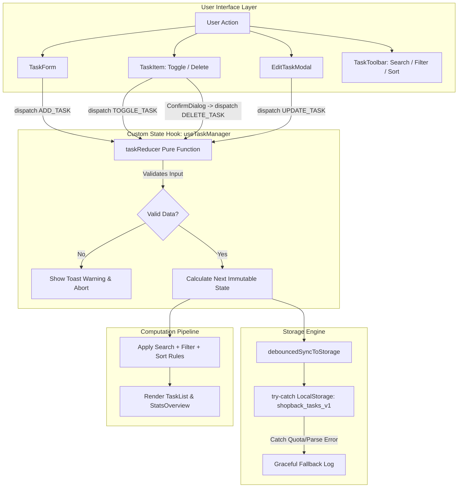

# Architecture Specification & Decision Records (Phase 0)
## Project: ShopBack TaskFlow — Industrial Standard To-Do Application

> **Document Type:** Technical Architecture Specification & Architecture Decision Records (ADR)  
> **Target Audience:** Engineering Candidate, Senior Interviewers, and Technical Auditors  
> **Status:** APPROVED FOR IMPLEMENTATION  
> **Author:** Antigravity (AI Pair Engineer) & Candidate (Technical Lead)  

---

## 1. System Context & Requirements Decomposition

The objective is to deliver a robust, highly reliable, and accessible To-Do management system adhering to industrial standards within a 2-to-3-hour assessment window.

### 1.1 Requirements Matrix

| Category | Requirement | Engineering Consideration |
| :--- | :--- | :--- |
| **Functional** | Full CRUD (Create, Read, Update, Delete) | Atomic actions, strict validation, safe deletion confirmations. |
| **Functional** | Completion State Management | Instant visual feedback, animated check transitions, strikethrough typography. |
| **Functional** | Search, Multi-Filter & Sorting | Live query debounce, status tabs, priority/category chips, multi-field sorting. |
| **Functional** | Persistence | Synchronized `localStorage` with versioned key and corrupted data recovery. |
| **Functional** | Productivity Metrics | Real-time counters (Total, Active, Completed) and completion percentage bar. |
| **Non-Functional** | Accessibility (WCAG 2.1 AA) | Semantic HTML (`button`, `dialog`, `label`), keyboard navigation (`Enter`, `Esc`), ARIA attributes. |
| **Non-Functional** | Resilience & Defensive Coding | Zero unhandled exceptions on invalid JSON, storage quota limits, or input whitespace. |
| **Non-Functional** | Performance & Bundle Size | < 150KB gzip, zero heavy UI component libraries, 60fps micro-animations. |
| **Non-Functional** | Deployability & DevOps | Multi-stage production `Dockerfile` with Nginx web server and `.dockerignore`. |

---

## 2. Architecture Decision Records (ADRs)

To allow technical auditing, every major architectural decision is recorded below using the standard ADR format: **Context, Decision, and Consequences/Rationale.**

### ADR-01: Framework Choice — React 19 + Vite
* **Context:** We need a frontend foundation that offers fast build speeds, modern developer experience, and minimal runtime overhead.
* **Options Considered:** Next.js (SSR/App Router), Plain Vanilla JS, React 19 + Vite.
* **Decision:** Adopt **React 19 with Vite 8**.
* **Rationale & Audit Defense:**
  - *Why not Next.js?* Next.js introduces Node.js server runtime requirements, SSR hydration overhead, and complex caching models that are unnecessary for a client-side offline-first To-Do app.
  - *Why Vite?* Vite leverages native ES Modules (Rollup for production build) ensuring sub-second dev server start and a pure static bundle that deploys to any static host or Nginx container.

---

### ADR-02: State Architecture — Custom Hook with Pure Reducer (`useReducer`)
* **Context:** The app requires state management for tasks (creation, updating, deletion, toggling, bulk operations) as well as UI state (active filters, search query, modals).
* **Options Considered:**
  1. Ad-hoc `useState` scattered across components (Spaghetti state).
  2. External state libraries: Redux Toolkit or Zustand.
  3. React native `useReducer` encapsulated inside a custom `useTaskManager` hook.
* **Decision:** Adopt **`useReducer` encapsulated within a dedicated `useTaskManager` hook**.
* **Rationale & Audit Defense:**
  - *Zero External Dependency:* Avoids adding 30KB+ to the dependency tree for Redux/Zustand.
  - *Determinism & Pure Functions:* The reducer `taskReducer(state, action)` is a 100% pure function, making state transitions deterministic and unit-testable without mocking React.
  - *Clear Action Contracts:* Every state mutation maps to an explicit action type (`ADD_TASK`, `UPDATE_TASK`, `DELETE_TASK`, `TOGGLE_TASK`, `CLEAR_COMPLETED`, `RESTORE_SEED`).
  - *Single Source of Truth:* Prevents desynchronization bugs between filtered views and persisted items.

---

### ADR-03: Persistence & Storage Strategy — Versioned Safe Storage Layer
* **Context:** The app must persist tasks across reloads using browser storage. Browser `localStorage` can throw exceptions (private browsing restrictions, storage quota exceeded, malformed JSON).
* **Decision:** Implement a defensive storage utility with a **versioned key contract (`shopback_tasks_v1`)**.
* **Rationale & Audit Defense:**
  - *Versioned Key (`shopback_tasks_v1`):* Prevents collision with other apps running on `localhost` and facilitates schema evolution without crashing existing users.
  - *Defensive Parsing (`try...catch`):* If `localStorage.getItem` returns corrupted JSON or if `setItem` throws `QuotaExceededError`, the storage layer intercepts the error, logs a warning, and falls back gracefully to default seed tasks rather than crashing the React root tree.
  - *Seed Data Hydration:* If the user clears their storage or visits for the first time, pre-seeded realistic tasks are loaded so the app looks alive immediately.

---

### ADR-04: Styling Architecture — Vanilla CSS Design Tokens (No Tailwind)
* **Context:** The styling must feel modern, responsive, and polished without creating dependency locks or bloated utility classes.
* **Decision:** Adopt **Vanilla CSS with CSS Custom Properties (Design Tokens)** organized in `index.css` and scoped component files.
* **Rationale & Audit Defense:**
  - *Native Theming:* Tokenized variables (`--bg-primary`, `--text-primary`, `--accent-primary`, `--border-color`) make Dark/Light theme switching instantaneous via a single `data-theme="dark"` attribute on the root element.
  - *No Build Tools Required for CSS:* Zero PostCSS/Tailwind configuration bugs; 100% portable CSS.
  - *Performance:* Modern CSS Grid and Flexbox with native transitions deliver 60fps rendering without CSS-in-JS runtime overhead.

---

### ADR-05: Component Hierarchy & Separation of Concerns (SRP)
* **Context:** A flat, single-file monolith is impossible to maintain, test, and audit.
* **Decision:** Deconstruct the UI into a 3-tier component hierarchy:
  1. **Container / Orchestrator:** `App.jsx` (hooks coordination, theme state).
  2. **Presentational & Action Blocks:**
     - `Header.jsx`: Logo, active date, theme toggle button.
     - `StatsOverview.jsx`: Metrics cards (Total, In Progress, Completed, % Progress bar).
     - `TaskForm.jsx`: Creation form with expandable options (Priority, Category, Due Date).
     - `TaskToolbar.jsx`: Search input, status filter pills, priority/category dropdowns, sorting selector.
     - `TaskList.jsx`: Mapping tasks or rendering `EmptyState.jsx`.
     - `TaskItem.jsx`: Individual task card with completion toggle, priority badge, relative due date, action buttons.
  3. **Safety Overlays & Dialogs:**
     - `EditTaskModal.jsx`: Accessible modal for editing existing tasks.
     - `ConfirmDialog.jsx`: Destructive action safety barrier (prevents accidental task deletion).

---

### ADR-06: Quality Assurance & Testing Boundary
* **Context:** We need to verify that code delivered adheres to industrial standards within our 2–3h time envelope.
* **Decision:** Use **Vitest + React Testing Library** targeting:
  1. *Invariant Verification:* Ensuring blank and whitespace-only submissions are blocked.
  2. *State Transition:* Ensuring task completion toggles accurately update state and derived metrics.
  3. *Persistence Verification:* Ensuring actions correctly sync with `localStorage`.

---

### ADR-07: Containerization Strategy — Multi-Stage Dockerfile + Nginx
* **Context:** The submission requires a production-ready mindset.
* **Decision:** Provide a 2-stage `Dockerfile`:
  - **Stage 1 (Build):** `node:20-alpine` runs `npm ci` and `npm run build`.
  - **Stage 2 (Run):** `nginx:alpine` hosts static output with an SPA routing configuration (`try_files $uri /index.html`).
* **Rationale:** Reduces container image size from ~600MB to ~25MB, runs zero Node.js daemon overhead in production, and provides production-grade asset serving.

---

## 3. Domain Model & Data Contracts

```typescript
/**
 * Strict TypeScript representation of Task entity
 */
export interface Task {
  id: string;                      // Generated via crypto.randomUUID()
  title: string;                   // Required, trimmed, 1 to 120 characters
  description?: string;            // Optional extra notes / context
  completed: boolean;              // Default: false
  priority: 'low' | 'medium' | 'high'; // Default: 'medium'
  category: 'work' | 'personal' | 'study' | 'other'; // Default: 'work'
  dueDate?: string;                // YYYY-MM-DD format (normalized to local midnight)
  createdAt: string;               // ISO-8601 string (new Date().toISOString())
  updatedAt?: string;              // ISO-8601 string
}

/**
 * Filter & Sort State Contract
 */
export interface FilterState {
  searchQuery: string;             // Filter by substring match on title & description
  status: 'all' | 'active' | 'completed';
  category: 'all' | 'work' | 'personal' | 'study' | 'other';
  priority: 'all' | 'low' | 'medium' | 'high';
  sortBy: 'newest' | 'oldest' | 'priority' | 'dueDate';
}
```

---

## 4. End-to-End System Data Flow



---

## 5. Failure Modes & Edge Case Analysis (FMEA Matrix)

| Failure Scenario | Risk Level | Technical Mitigation Strategy |
| :--- | :---: | :--- |
| **User enters spaces only (`"   "`)** | Medium | In `taskReducer`, apply `action.payload.title.trim()`. If string is empty, throw a client warning toast and abort state mutation. |
| **Extremely long string without spaces** | Medium | Apply CSS `overflow-wrap: break-word` and `word-break: break-word` on task title elements to prevent card layout blowout. |
| **`localStorage` is disabled or full** | High | Wrap `localStorage.setItem` in a `try...catch`. In event of `QuotaExceededError`, notify user with a toast and keep in-memory state functional. |
| **Accidental task deletion** | High | Trigger `ConfirmDialog` modal before executing `DELETE_TASK`. Do not delete immediately on click. |
| **Due date timezone offsets** | Medium | Normalize due date strings to local midnight (`YYYY-MM-DD` compared against local date at `00:00:00`) so tasks due today are not falsely marked "overdue" during daylight hours. |
| **Corrupted JSON in `localStorage`** | High | In initial hydration, if `JSON.parse` fails, reset storage to `DEFAULT_SEED_TASKS` cleanly and log warning rather than throwing unhandled runtime exception. |

---

## 6. Audit Verification Checklist for Candidate

Use this checklist to audit the implementation against this architecture specification:

- [ ] **Architecture Check:** Is state logic cleanly separated in a custom hook/reducer, keeping `App.jsx` readable?
- [ ] **Data Model Check:** Does every task have `id`, `title`, `completed`, `priority`, `category`, and timestamps?
- [ ] **Storage Key Check:** Is the storage key strictly versioned (`shopback_tasks_v1`)?
- [ ] **Defensive Check:** Does entering `"   "` fail gracefully without adding an empty task?
- [ ] **Safety Check:** Does clicking the delete icon trigger a confirmation dialog?
- [ ] **Accessibility Check:** Can you navigate and toggle tasks using keyboard (`Tab`, `Space`, `Enter`, `Escape`)?
- [ ] **QA Check:** Do automated tests pass with `npm test`?
- [ ] **Container Check:** Does `docker build` run and produce a functional container?

---

*Phase 0 Architecture Specification complete and ready for Phase 1 Prompting.*
