# ShopBack Engineering Intern Take-Home Assessment: Strategy & Execution Plan

> **Role:** Engineering Intern (ShopBack)  
> **Challenge:** AI-Assisted App — To-Do List Application  
> **Time Limit:** 2 – 3 Hours (recommended 15 minutes reserved for packaging)  
> **Document Purpose:** An industrial-standard guide, blueprint, and tactical checklist designed for fresh graduates to score top marks on engineering judgment, AI collaboration, and product robustness.

---

## 1. Deconstructing the ShopBack Evaluation Rubric

Before writing a single line of code or crafting a prompt, you must understand how senior engineers and hiring managers at ShopBack evaluate this test.

### What ShopBack Is Actively Looking For:
| Criteria | What It Means in Practice | How to Demonstrate It |
| :--- | :--- | :--- |
| **How you think before prompting** | You don't jump into AI like a novice saying *"Build me a to-do list app"*. You analyze data models, state transitions, failure modes, and architectural boundaries first. | Well-structured technical requirements in your initial prompt and authentic decomposition in `reflection.md`. |
| **How you course-correct AI mistakes** | AI generates naive, buggy, or unoptimized code (e.g. unhandled storage exceptions, race conditions, lack of accessibility, UI glitches). You catch and correct them. | Pinpointing concrete flaws (validation, edge cases, UX traps) and explaining your code-level fixes in `reflection.md`. |
| **Whether you understand what you ship** | You can explain every architectural decision, hook, data contract, and styling token during the technical interview. | Clean, modular codebase; avoid bloated external libraries or magical code you cannot defend. |

### What They Do NOT Care About:
- **Whether the app is over-engineered or overly flashy:** A rock-solid, bug-free, accessible app with 5 core features beats a broken, glitchy app with 20 features.
- **Code perfection:** They know you had 2–3 hours. They look for pragmatic engineering instincts.
- **Which specific AI tool you used:** Claude, ChatGPT, Cursor, or Copilot are all fine.

---

## 2. Deliverables Checklist & Strict Constraints

The prompt requires a single ZIP file containing:

```
project-root/
├── src/                     # Working application source code
├── public/                  # Static assets (if any)
├── Screenshots/             # Folder containing clean UI screenshots
│   ├── 01_dashboard.png
│   ├── 02_task_creation.png
│   ├── 03_edit_modal.png
│   └── 04_mobile_view.png
├── README.md                # Clear setup & run instructions
├── prompt.md                # Exact initial prompt (RAW, UNEDITED)
├── reflection.md            # AI usage write-up (STRICTLY <= 500 words)
├── package.json             # Minimal dependencies & scripts
├── .gitignore               # node_modules, dist, .DS_Store ignored
└── [config files]           # vite.config.js, index.html, etc.
```

### ⚠️ Fatal Traps to Avoid:
1. **Never include `node_modules` or `dist` in the ZIP file:** This inflates the ZIP from ~2MB to 150MB+ and looks unprofessional. Test extraction and run `npm install && npm run dev` on a clean folder.
2. **Strict Word Count on `reflection.md`:** The rubric states **maximum 500 words**. Exceeding this shows a lack of attention to specifications. Aim for 420–480 words.
3. **Prompt Honesty & Alignment:** Do not write an initial prompt that says *"Build me an app"* while claiming in `reflection.md` that you gave the AI a granular, 5-page enterprise specification. Align your actual prompt with your real thought process.

---

## 3. Recommended 3-Hour Time Allocation

```mermaid
gantt
    title 3-Hour ShopBack Take-Home Assessment Timeline
    dateFormat mm
    axisFormat %H:%M

    section Phase 0: Analysis
    Problem Breakdown & Architecture (00-20m) : 0, 20m

    section Phase 1: Prompting
    Initial Prompt Crafting (20-35m)         : 20, 15m

    section Phase 2: Core Build
    Scaffold & Core CRUD Persistence (35-75m)  : 35, 40m
    Course-Correction & Refactoring (75-105m) : 75, 30m

    section Phase 3: Polish & QA
    Automated Tests (Vitest) & Edge Cases (105-135m): 105, 30m

    section Phase 4: Docs
    Screenshots & Reflection (135-165m)       : 135, 30m

    section Phase 5: Packaging
    Sanity Check & Clean ZIP (165-180m)       : 165, 15m
```



---

## 4. Phase-by-Phase Industrial Execution Plan

### Phase 0: Pre-Prompt Engineering Breakdown (20 mins)
*Do this on paper or in a quick markdown scratchpad before touching the AI.*

1. **Data Model Definition:**
   ```typescript
   interface Task {
     id: string;              // crypto.randomUUID()
     title: string;           // Trimmed, 1-120 chars
     description?: string;    // Optional notes
     completed: boolean;      // Default false
     priority: 'low' | 'medium' | 'high';
     category: 'work' | 'personal' | 'study' | 'other';
     dueDate?: string;        // ISO date string (YYYY-MM-DD)
     createdAt: string;       // ISO timestamp
   }
   ```
2. **State & Mutation Contracts:**
   - `createTask(title, metadata)`
   - `toggleTask(id)`
   - `updateTask(id, fields)`
   - `deleteTask(id)` (with safety check/confirmation)
   - `clearCompleted()`
3. **Persistence Strategy:**
   - Key: `shopback_todo_v1` (versioned key prevents schema migration crashes).
   - Safe parsing: Wrap `localStorage.getItem` in `try / catch` with default fallback seed data to handle private browsing mode or corrupted JSON.
4. **Edge Cases to Guard Against:**
   - Submitting whitespace-only titles (`"   "`).
   - Extremely long task titles without CSS text wrapping (breaking UI layout).
   - LocalStorage quota exceeded (`QuotaExceededError`).
   - Modal keyboard trap (pressing `Escape` to close, pressing `Enter` to submit).

---

### Phase 1: Initial Prompt Crafting (`prompt.md`) (15 mins)

The instructions require:
> *"A plain text file containing your exact initial AI prompt. Paste it as-is. No cleaning it up."*

An industrial-grade prompt shows that **you** are the technical lead directing the AI, rather than asking the AI to guess the requirements:

```markdown
Act as a Senior React Frontend Engineer. I am building a production-grade, highly responsive To-Do List web application using React + Vite and Vanilla CSS design tokens.

Here is the exact technical scope and architecture I require:
1. Core Features:
   - Full CRUD: Add task, view tasks, edit task (modal or inline), delete task with confirmation dialog.
   - Toggle task completion with animated visual feedback.
   - Filtering & Search: Filter by status (All, Active, Completed), Category (Work, Personal, Study, Other), Priority (High, Medium, Low), and live title search.
   - Sorting: By newest, oldest, priority, and due date.
   - Persistence: LocalStorage synchronized with schema version 'shopback_todo_v1' and safe JSON parsing fallback.

2. Architecture & Code Quality Standards:
   - Clean, modular component structure under src/components/ (Header, StatsBar, TaskForm, TaskToolbar, TaskList, TaskItem, EditModal, ConfirmDialog).
   - Maintain a centralized constants file for categories, priorities, and seed data.
   - Pure CSS custom properties (variables) for theme tokens (dark/light mode support), smooth transitions, and responsive mobile-first layout.
   - Semantic HTML and accessibility: proper button elements, input labels, aria-labels, and keyboard shortcuts (Enter to add, Escape to cancel).
   - Zero bulky external UI component libraries (e.g. no Material UI/AntD); use lightweight Lucide icons.

3. Edge Cases to Handle:
   - Trim text inputs and block empty/whitespace-only submissions.
   - Prevent layout breakage from long continuous strings (CSS word-break).
   - Date calculations: highlight overdue tasks accurately without timezone offset bugs.

Please generate the project scaffolding, CSS design tokens, and components adhering strictly to these specifications.
```

---

### Phase 2: Implementation & Critical Course-Correction (70 mins)

This is where you earn the highest points on the evaluation rubric. **Keep a quick note of what AI got wrong as you code so you can write `reflection.md` effortlessly.**

#### Common AI Mistakes You Should Inspect and Fix:
1. **Direct State Mutations:**
   - *AI flaw:* AI often mutates arrays directly (`tasks.splice()` or mutating task properties in-place).
   - *Your fix:* Ensure immutable updates: `setTasks(prev => prev.map(t => t.id === id ? { ...t, completed: !t.completed } : t))`.
2. **Missing LocalStorage Error Handling:**
   - *AI flaw:* Direct `JSON.parse(localStorage.getItem(...))` without checking for `null`, invalid JSON, or storage quota blocks.
   - *Your fix:* Encapsulate in a safe custom hook (`useLocalStorage`) with error fallback.
3. **Destructive Actions Without Confirmation:**
   - *AI flaw:* Clicking delete immediately removes the item, causing accidental data loss.
   - *Your fix:* Introduce a reusable `ConfirmDialog` component.
4. **Timezone & Date Math Glitches:**
   - *AI flaw:* Comparing `task.dueDate < new Date()` compares exact millisecond timestamps, marking tasks due today as "overdue" at 9 AM.
   - *Your fix:* Normalize both dates to midnight local time for fair day-based comparison.
5. **Accessibility Flaws:**
   - *AI flaw:* Using `<div onClick={...}>` instead of `<button>` or missing `aria-label` on icon-only buttons.
   - *Your fix:* Replace with semantic `<button type="button">` and accessible titles.

---

### Phase 3: Edge Case Testing & Visual Polish (30 mins)

Before taking screenshots, run through this Quality Assurance (QA) test matrix:

- [ ] **Whitespace validation:** Try submitting `    ` -> form should reject or stay disabled.
- [ ] **Long strings:** Add a task with `WWWWWWWWWWWWWWWWWWWWWWWWWWWWWWWWWWWWWWWWWWWWWWWW` -> ensures `overflow-wrap: break-word` prevents container overflow.
- [ ] **Empty list state:** Filter by a non-existent word -> display a clean, friendly empty state with an icon and clear message.
- [ ] **Persistence test:** Refresh the browser, reopen in an incognito window -> verify sample seed data loads cleanly without console errors.
- [ ] **Keyboard navigation:** Press `Tab` through elements, `Enter` to create task, `Escape` to close modals.
- [ ] **Responsiveness:** Test in browser dev tools at 375px (iPhone SE) and 768px (iPad).

---

### Phase 4: Screenshots, README, & Reflection Writing (35 mins)

#### 1. Screenshots Folder (`/Screenshots`):
Capture 4 to 5 high-resolution, informative screenshots:
- `01_dashboard_overview.png`: Clean initial view showing task statistics and active list.
- `02_task_creation_expanded.png`: Form showing categories, priorities, and date pickers.
- `03_completed_tasks_filter.png`: Showing filters, search query, and completed strikethrough.
- `04_edit_and_confirm_modals.png`: Showing user safety workflows.
- `05_theme_toggle_or_mobile.png`: Demonstrating responsiveness.

#### 2. Crafting `README.md`:
Must include:
- Clear 1-line project overview.
- Prerequisites (Node.js version).
- Setup instructions (`npm install`, `npm run dev`, `npm run build`).
- Project structure tree.
- Key architectural decisions and feature highlights.

#### 3. Crafting `reflection.md` (Strictly Under 500 Words):
Structure your 4 answers clearly and concisely.

*Example High-Scoring Structure:*
- **Q1: Problem breakdown before prompting:** Explain your 4-layer breakdown (Data schema, State & CRUD mutations, Search/Filter pipeline, UI component hierarchy).
- **Q2: What AI got wrong & how you fixed it:** Cite 3 concrete technical corrections (e.g. destructive action confirmation, midnight-normalized overdue date comparison, whitespace validation).
- **Q3: What you deliberately did NOT delegate to AI & why:** Architectural boundaries, storage key versioning strategy (`shopback_todo_v1`), and interactive accessibility validation.
- **Q4: What would you do differently with more time:** Unit/Integration testing with Vitest/React Testing Library, optimistic offline sync via IndexedDB, and drag-and-drop reordering.

---

### Phase 5: Packaging & Final Sanity Check (15 mins)

1. **Verify Root Directory Structure:**
   Ensure all 5 required items are present:
   - Application codebase (`src/`, `package.json`, etc.)
   - `README.md`
   - `prompt.md`
   - `Screenshots/`
   - `reflection.md`
2. **Double-Check Exclusions:**
   Ensure `.gitignore` contains:
   ```
   node_modules
   dist
   .DS_Store
   *.log
   ```
3. **Archive to ZIP:**
   Create the zip file (excluding `node_modules` and `dist`):
   ```powershell
   # Windows PowerShell command to zip properly
   Compress-Archive -Path src, public, Screenshots, index.html, package.json, vite.config.js, README.md, prompt.md, reflection.md -DestinationPath shopback-intern-takehome.zip
   ```
4. **Clean Verification Test:**
   - Extract the generated ZIP to a separate temporary directory.
   - Run `npm install && npm run build && npm run preview`.
   - Confirm zero build warnings, zero missing assets, and zero runtime errors.

---

## 5. Docker (Deployment) & QA (Testing): Should You Add Them?

Candidates often wonder whether containerization (Docker) and automated testing (QA) are expected for an intern take-home test. 

Here is the exact industrial assessment of **ROI (Return on Investment) vs. Risk** within your 2–3 hour time budget:

### Summary Matrix
| Feature | Include in 2-3h Test? | Time Cost | Impact on Evaluation Rubric |
| :--- | :---: | :---: | :--- |
| **QA (Vitest Unit/Integration Tests)** | **YES (Highly Recommended)** | ~15–20 mins | **Massive.** Proves *"you understand what you shipped"* and provides concrete evidence for `reflection.md` (Q2 & Q3). |
| **Docker (`Dockerfile` + Nginx)** | **YES (Lightweight / Secondary)** | ~5 mins | **High Polish.** Signals DevOps literacy and production readiness, but keep standard `npm run dev` as the primary instruction. |
| **CI/CD Pipeline (GitHub Actions)** | **Optional / Mention in Reflection** | ~10 mins | Great to mention in `reflection.md` under Question 4 (*"What I would do differently with more time"*). |

---

### Part A: Automated QA & Testing Strategy (The 15-Minute High-Yield Plan)

Do not spend 1 hour trying to achieve 100% test coverage. Write **3 to 4 surgical tests** that target critical business logic and AI failure points.

#### 1. Setup Vitest & React Testing Library (3 mins)
Add testing dependencies to `package.json`:
```bash
npm install -D vitest @testing-library/react @testing-library/jest-dom @testing-library/user-event jsdom
```

Configure `vite.config.js`:
```javascript
import { defineConfig } from 'vite';
import react from '@vitejs/plugin-react';

export default defineConfig({
  plugins: [react()],
  test: {
    globals: true,
    environment: 'jsdom',
    setupFiles: './src/test/setup.js',
  },
});
```

Add `npm test` script in `package.json`:
```json
"scripts": {
  "dev": "vite",
  "build": "vite build",
  "preview": "vite preview",
  "test": "vitest run"
}
```

#### 2. The 3 Surgical Tests to Write (`src/test/TaskFlow.test.jsx`)
These 3 tests directly validate the evaluation rubric:

```javascript
import { render, screen } from '@testing-library/react';
import userEvent from '@testing-library/user-event';
import { describe, it, expect, beforeEach } from 'vitest';
import App from '../App';

describe('TaskFlow Industrial Sanity & Edge-Case Tests', () => {
  beforeEach(() => {
    localStorage.clear();
  });

  it('Edge Case: Blocks submission of empty or whitespace-only tasks', async () => {
    const user = userEvent.setup();
    render(<App />);

    const input = screen.getByPlaceholderText(/what needs to be done/i);
    const addButton = screen.getByRole('button', { name: /add task/i });

    // Try typing whitespace only
    await user.type(input, '     ');
    await user.click(addButton);

    // Verify task is NOT created
    expect(screen.queryByText(/^     $/)).not.toBeInTheDocument();
  });

  it('Core Flow: Successfully creates a new task and displays it in the list', async () => {
    const user = userEvent.setup();
    render(<App />);

    const input = screen.getByPlaceholderText(/what needs to be done/i);
    await user.type(input, 'Finish ShopBack Take-Home Test{enter}');

    expect(screen.getByText('Finish ShopBack Take-Home Test')).toBeInTheDocument();
  });

  it('Persistence Flow: Persists newly created tasks into localStorage', async () => {
    const user = userEvent.setup();
    render(<App />);

    const input = screen.getByPlaceholderText(/what needs to be done/i);
    await user.type(input, 'Persistent Task Item{enter}');

    const storedData = JSON.parse(localStorage.getItem('taskflow_tasks_v1') || '[]');
    const exists = storedData.some(t => t.title === 'Persistent Task Item');
    expect(exists).toBe(true);
  });
});
```

#### 3. How to Leverage This in `reflection.md`:
* In **Q2 (What AI got wrong):** *"When AI generated the form submission handler, my automated edge-case test revealed that entering pure whitespace ('   ') bypassed the length check. I fixed this by adding strict input trimming before dispatching state."*
* In **Q3 (What you did not delegate):** *"I deliberately hand-wrote the test specs rather than asking AI to write both code and tests simultaneously. Hand-writing test specs established a ground-truth contract that caught AI hallucinations."*

---

### Part B: Dockerization Strategy (Production Multi-Stage Build)

A clean `Dockerfile` demonstrates that you understand how a Single Page Application (SPA) runs in production (static assets served via an optimized Nginx web server, rather than running a development server inside Docker).

#### 1. Multi-Stage `Dockerfile` (Save at project root)
```dockerfile
# Stage 1: Build the Vite SPA
FROM node:20-alpine AS builder
WORKDIR /app
COPY package*.json ./
RUN npm ci
COPY . .
RUN npm run build

# Stage 2: Serve with lightweight Nginx
FROM nginx:alpine
COPY --from=builder /app/dist /usr/share/nginx/html
COPY nginx.conf /etc/nginx/conf.d/default.conf
EXPOSE 80
CMD ["nginx", "-g", "daemon off;"]
```

#### 2. Clean `nginx.conf` (Ensures SPA client-side routing works)
```nginx
server {
    listen 80;
    server_name localhost;

    location / {
        root /usr/share/nginx/html;
        index index.html index.htm;
        try_files $uri $uri/ /index.html;
    }

    error_page 500 502 503 504 /50x.html;
    location = /50x.html {
        root /usr/share/nginx/html;
    }
}
```

#### 3. `.dockerignore` (Prevents bloating build context)
```
node_modules
dist
.git
Screenshots
*.zip
*.md
```

#### 4. Documenting Docker in `README.md`
**Crucial Rule:** Make sure Node.js `npm run dev` remains the **primary** quick-start instruction, and offer Docker as an optional alternative:

```markdown
### Option A: Standard Local Setup (Recommended)
```bash
npm install
npm run dev
```

### Option B: Docker Container Deployment
```bash
docker build -t shopback-taskflow:latest .
docker run -d -p 8080:80 --name taskflow-app shopback-taskflow:latest
```
Visit `http://localhost:8080` in your browser.
```

---

## 6. Technical Interview Follow-Up Cheatsheet

If your submission passes, you will be invited to a technical interview where engineers review your code and ask questions about your thought process. Be prepared for:

| Expected Question | Strong Industrial-Grade Answer |
| :--- | :--- |
| *"Why did you use `localStorage` over IndexedDB?"* | *"For a simple To-Do application with under 1,000 items, `localStorage` provides synchronous, zero-dependency persistence that meets all prompt requirements without introducing async complexity. However, for large datasets or blob storage, I would migrate to IndexedDB to avoid blocking the main thread."* |
| *"How did you prevent race conditions or schema corruption in storage?"* | *"I versioned the key (`shopback_todo_v1`), wrapped parse/stringify in defensive `try/catch` blocks with fallback seed data, and debounced persistent writes to reduce I/O thrashing."* |
| *"Did the AI write all this code? How much was yours?"* | *"AI acted as my rapid boilerplate accelerator. I defined the data models and component boundaries first, generated the initial scaffolding via AI, and then manually refactored edge cases, safety dialogs, and accessibility standards myself."* |
| *"How would you add automated tests to this?"* | *"I would use Vitest and React Testing Library to write unit tests for the reducer/custom hook logic, plus integration tests verifying that tasks persist across page reloads and cannot be added with blank text."* |

---

*Authored for ShopBack Engineering Intern Take-Home Challenge — Industrial Best Practices.*
